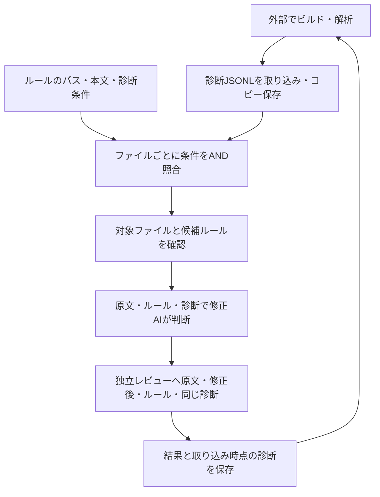

# 外部診断を使った対象・ルールの絞り込み

ビルドや解析はアプリ外で実行し、その結果をJSONLとして取り込みます。OneByOneは診断とルールの条件を機械的に照合し、ファイルごとに候補ルールと診断を修正AI・独立レビューへ渡します。ソリューションやコンパイラーの種類には依存しません。

## 入力形式

UTF-8のJSONLで1行につき1診断です。UTF-8 BOM・空行は許容します。プロパティは以下の4つに固定し、不明なプロパティ・同じキーの重複・null・型違いは取り込みエラーになります。

| プロパティ | 必須 | 意味 |
|---|---|---|
| `file` | 必須 | 対象フォルダからの相対パス。Windowsの`\`は`/`へ正規化。対象ファイルとの対応付けは大文字・小文字を区別 |
| `message` | 必須 | 空白以外の診断メッセージ |
| `line` | 任意 | 1始まりの正整数。場所が不明なら省略 |
| `code` | 任意 | エラーコードなどの文字列 |

```jsonl
{"file":"src/OrderWriter.cs","line":42,"code":"CS0619","message":"Store.Save is obsolete; use Store.WriteAsync."}
{"file":"src/OrderWriter.cs","line":81,"code":"CS1061","message":"Store does not contain a definition for Finish."}
{"file":"src/OtherWriter.cs","message":"保存完了前に通知しています。"}
```

絶対パス・ドライブ名・親への移動（`..`）は受け付けません。WindowsのパスをJSONへ書く場合は`\\`とエスケープしてください。完全に同じ診断は重複排除します。複数ソリューションから同じ物理ファイルの診断を集める場合も、同じ`file`へまとめます。ソリューション名が判断材料になる場合は`message`へ含めてください。

入力は通常ファイル・32 MiB以内です。空の診断ファイルは受け付けません。診断がなくなった場合は「解除」を使います。読み込みに失敗しても、既に取り込んだ診断は維持します。

## ルール条件

ルールのfront matterへ任意の`diagnostic_pattern`を追加します。

```markdown
---
id: R019
name: 保存APIの非同期化
description: 保存完了を確認してから後続処理へ進める。
path_pattern: 'src/**/*.cs'
content_pattern: '\.Save\s*\('
diagnostic_pattern: '\bCS0619\b.*Store\.Save'
---

# 変更概要

廃止された保存APIを非同期APIへ変更し、結果を利用する処理の前に完了を待つ。
既存の例外処理を維持する。呼び出し側の契約変更が必要なら判断を保留する。
```

条件の指定された項目を**AND**で結びます。

- `path_pattern`: 対象フォルダ基準の相対パスへ大文字・小文字を区別せずglob照合。
- `content_pattern`: 対象ファイル本文へripgrepの正規表現で照合。既定では大文字・小文字を区別せず、`(?-i)Save`のように`(?-i)`を付けると区別。
- `diagnostic_pattern`: そのファイルの**同じ診断1件の`code + " " + message`**へGoの正規表現（RE2構文）で照合。既定では大文字・小文字を区別。`code`省略時は先頭の空白＋`message`。少なくとも1件に一致すれば成立。

3条件が空なら共通ルールです。診断条件が指定されているルールは、診断を取り込んでいない場合や一致する記録がない場合には候補になりません。診断条件を設定しないルールは従来どおりパスと本文で判定します。

「診断のあるファイルだけを対象にする」をオンにすると、共通ルールを含め、取り込んだ診断があるファイルだけを候補にします。オフでも診断条件付きルールの条件は有効です。どちらの場合も固定除外、選択したルール、実行対象のチェックボックスは適用されます。診断にファイル名があるだけでは対象にならず、少なくとも1ルールの条件との一致が必要です。

CSVでは`diagnostic_pattern`は任意列です。従来の必須5列は変更せず、テンプレートには追加してあります。CLIの単一ルールJSONでは`diagnosticPattern`を使います。

## 操作

1. 外部ツールでビルド・解析し、診断JSONLを作成します。
2. ルールに必要な診断条件と修正方針を設定します。
3. 実行設定の「診断JSONLを取り込む」からファイルを選びます。必要なら診断のあるファイルだけに限定します。
4. 再抽出された対象と候補ルール、選択ファイルの「取り込んだ診断」を確認して実行します。
5. 結果確認でもその試行に渡した診断を確認できます。修正後のコンパイルは外部で実施し、再実行したい場合は新しい診断を取り込んで対象を更新します。

GUIでは取り込み・差し替え・解除・限定設定の変更後に対象を再抽出します。CLIは明示的に`scan`します。取り込み直後に既存の完了状態を自動で未修正へ戻すことはありません。再処理するファイルは通常の再試行操作で選択します。

```sh
./onebyone diagnostics import --input ./diagnostics.jsonl --workspace WORKSPACE_ID
./onebyone diagnostics show --workspace WORKSPACE_ID --json
./onebyone scan --workspace WORKSPACE_ID
./onebyone diagnostics clear --workspace WORKSPACE_ID
```

限定設定は`settings update --input settings.json`で`{"diagnosticsOnly":true}`を指定します。診断未取込ではオンにできません。コピーの保存先はアプリが管理し、設定画面・CLIから任意のパスには変更できません。

## 保存とAIへの渡し方

取り込みごとにワークスペース配下の`diagnostics/<版ID>/diagnostics.jsonl`へコピーします。元のファイルを後から書き換えても反映されません。元のJSONLが対象フォルダ内にある場合は、その相対パスだけを記録し、取り込み中はそのファイルを修正対象から除外します。ビルドが作る未追跡ファイルなどでGitの作業状態を汚さないよう、外部で生成する診断の保存先は対象フォルダ外を推奨します。再取り込みで新しいコピーへ切り替え、解除では参照だけを外します。ワークスペースの複製は独立したコピーを作り、対象フォルダの変更では現在の診断を解除します。

診断内容と限定設定は抽出条件のハッシュに含めます。変更後に古い抽出結果や修正途中の計画をそのまま再利用しません。キューにはファイル単位の`sourceDiagnostics`を保存し、各試行にもコピーします。診断の`ruleIds`はアプリが追加する「その診断の条件に一致した候補ルール」で、実際の修正済みルールを意味しません。入力JSONLへは書けません。

修正AIには対象コード・候補ルール・そのファイルの診断を渡します。会話容量を超える診断は`read_state`の`diagnostics`でページ取得できます。独立レビューにも同じ診断を渡し、大きい場合は`read_review_catalog`からページ取得させます。編集者の判断をそのままレビューの根拠としては渡しません。

診断の文面は指示として実行させず、外部の参考情報として扱います。行番号が現在のコードとずれている可能性もあるため、実際のコードとルールを確認させます。診断は取り込み時点の記録であり、独立レビューの合格は再ビルドの成功を意味しません。


